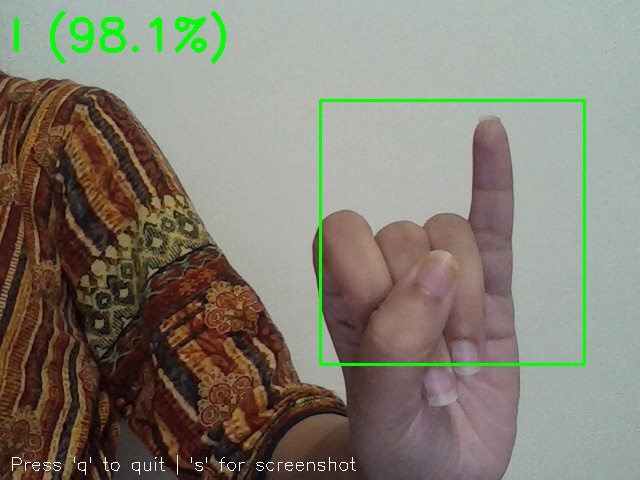
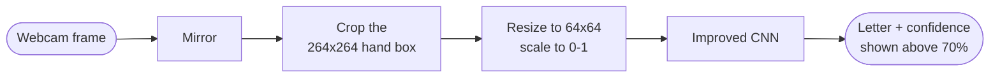

# ASL Sign Language Recognition with CNN and OpenCV ✋

**Real-time recognition of the American Sign Language alphabet from a webcam.**

[](https://github.com/amnanazir101-maker/asl-sign-language-recognition/actions/workflows/ci.yml)


A convolutional neural network trained on 87,000 images classifies a hand sign into 29 classes
(A-Z, *space*, *delete*, *nothing*). An OpenCV app runs it live on a laptop webcam.



## Results

Accuracy on the validation set: 17,400 images (20% of the dataset) that the models never trained on.

| Model | Parameters | Data augmentation | Training accuracy | Validation accuracy | Overfitting gap |
|---|---|---|---|---|---|
| Baseline CNN (3 convolutional layers) | 686,941 | No | 98.8% | 83.0% | 15.8 points |
| **Improved CNN** (4 blocks, batch norm, L2, dropout) | 1,671,485 | Yes | 93.5% | **94.2%** | none |

The improved model is **11.2 points more accurate on unseen images** and no longer overfits:
its validation accuracy is as high as its training accuracy.

> The dataset also ships a 28-image test folder (one image per class). Both models classify all
> 28 correctly, which is why the larger validation set is used for the comparison.

## How it works



1. **Data**: the [ASL Alphabet dataset](https://www.kaggle.com/datasets/grassknoted/asl-alphabet):
   87,000 RGB images, 3,000 per class. 80% for training (69,600 images) and 20% for
   validation (17,400), resized to 64 x 64.
2. **Baseline CNN**: three convolution and max-pooling blocks with a 128-unit dense layer. It
   memorised the training images (98.8%) but reached only 83.0% on validation images.
3. **Improved CNN**: four convolutional blocks with batch normalization, L2 weight decay and
   dropout, trained with data augmentation (rotation up to 20°, 20% shifts, shear, 20% zoom,
   horizontal flips). The Adam optimizer runs with learning-rate reduction on plateaus, early
   stopping and checkpointing of the best epoch.
4. **Real-time app**: OpenCV reads the webcam, mirrors the frame, crops the hand box and
   classifies it every 5 frames. A letter appears once the model is at least 70% confident,
   with the next two guesses and the frame rate underneath.

## Quickstart

```bash
git clone https://github.com/amnanazir101-maker/asl-sign-language-recognition.git
cd asl-sign-language-recognition
python -m venv .venv
.venv\Scripts\activate            # macOS/Linux: source .venv/bin/activate
pip install -r requirements.txt
```

**Live webcam app**: hold your hand inside the green box (q quits, s saves a screenshot):

```bash
python detect_webcam.py
```

**Images**:

```bash
python predict_image.py assets/sample_I.jpg
```

```
sample_I.jpg: I 90.9%, M 4.1%, A 3.3%
```

For best results use a plain background and good light, like the training images.

## Retraining

[`notebooks/train_asl_cnn.ipynb`](notebooks/train_asl_cnn.ipynb) runs in Google Colab: it loads the
dataset, trains and compares both models, and saves the model used by the app
(`models/asl_cnn.h5`).

## Project structure

```
asl_recognizer.py      loads the model; preprocessing and top-k prediction
detect_webcam.py       real-time OpenCV app
predict_image.py       predictions for image files
models/                trained CNN (asl_cnn.h5) and class names (classes.json)
notebooks/             training notebook (baseline vs improved CNN)
assets/                demo screenshot and a sample hand image
tests/                 class list, preprocessing, and a live prediction of the sample image
```

## Tests

```bash
pytest
```

The tests check the class list, that preprocessing matches the training input (RGB, 64 x 64,
scaled to 0-1), and that the trained model reads the sample image as the letter I. GitHub
Actions runs them on every push.

## Roadmap

- Find the hand with a hand-landmark model (for example MediaPipe) instead of a fixed box.
- Turn letter sequences into words and sentences.
- Export to TensorFlow Lite for phones.

## Author

**Amna Nazir** ([@amnanazir101-maker](https://github.com/amnanazir101-maker)). Built as a team
course project at the National University of Computer and Emerging Sciences (FAST), Islamabad,
in 2025, alongside our paper *Sign Language Recognition Using CNN and OpenCV*.

Dataset: [ASL Alphabet](https://www.kaggle.com/datasets/grassknoted/asl-alphabet) by Akash Nagaraj on Kaggle.

## License

[MIT](LICENSE)
